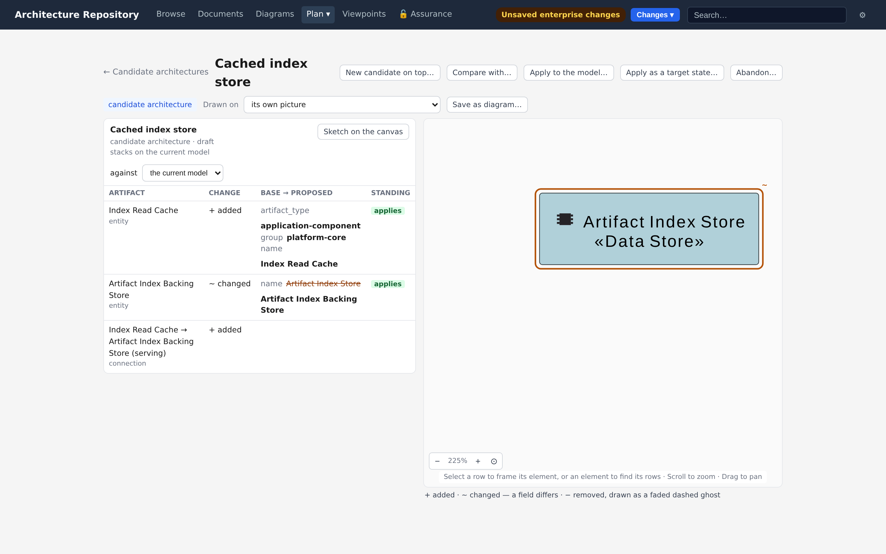
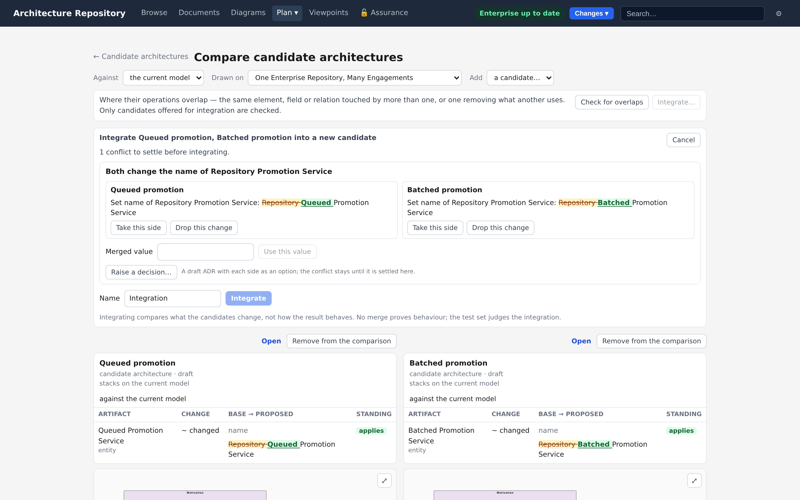

# Candidate architectures

A candidate architecture is a named alternative to the model: a list of changes that is read on top
of the model as it is now, compared with other candidates, and written into the model only when it is
applied. This page shows how to work with candidates in the GUI, explains how they relate to the
model, and then describes the same operations for agents and scripts, together with arranging and
saving a diagram through the API.

&nbsp;

## Work with a candidate in the GUI

Candidates are listed under **Plan › Candidate architectures**. The worked example below proposes a
read cache in front of the self-model's *Artifact Index Store*, compares two ways of changing
promotion, and integrates them.

### Create a candidate and sketch it

1. Select **New candidate architecture…**, give it a name (*Cached index store*), and select
   **Create**. A candidate is defined on its canvas, so it starts empty and reads over nothing until
   elements are placed on it. Under **Start** you can choose a seed instead:
   - **seeded with what a diagram draws** — it reads over the diagram's elements and is drawn on its
     picture;
   - **on top of a candidate** — it stacks on that candidate, and its changes are read over the
     other's.
2. On the candidate's page, select **Sketch on the canvas**. The canvas is the diagram editor's: find
   *Artifact Index Store* under **Add from model** and drag it on, right-click the paper to create
   *Index Read Cache* as an application component, and draw a relation between the two. A rename,
   a new element and a new relation each become an operation of the candidate.
3. Each change is saved to the candidate as you make it; the bar shows when. **Undo** takes the last
   one back out of the candidate. **Done sketching** returns to the page.

A candidate needs no stored diagram. Without one, its picture is generated from the model elements
it reads over and the relations among them. **Drawn on** chooses a stored diagram to draw it on
instead.

The page lists the operations beside the picture, each with its **standing** against the model:
*applies*, *already there*, *drifted* or *conflicting*. On the picture, `+` marks an added element,
`~` a changed one, and an element the candidate removes stays drawn as a faded dashed ghost.

A changed text field is compared word by word. Unchanged words are shown plain, removed words are
struck through and inserted words are marked, and a screen reader announces each removal and
insertion. A long unchanged stretch is folded to *… 12 words unchanged …*; select it to read it. A
short value such as a status, an id or a number is shown replaced whole. For a keyed field such as
`properties`, each changed key is named and only its value is compared. The same reading is used on
the candidate page, in a comparison, on a stress analysis's tabs, in the integration cards and in the
dry runs of **Apply to the model…** and **Apply as a target state…**.

Under the candidate's name, the operations panel shows its **description**: the core idea in a
sentence or two, at most 300 characters, such as *Every promotion passes a review step before it is
published.* Select **Describe…** or **Edit** to write it. The description is distinct from the
rationale, which holds the longer argument for the candidate and has no length limit.

**⤢** (*View fullscreen*) in the canvas's corner shows the picture full screen, and **Esc** returns.
While sketching, the bar with **Undo** and **Done sketching**, the canvas and **Add from model** go
full screen together, and the right-click menu opens over the canvas.

When the model has moved under an operation since it was recorded, the page says **Model moved** and
offers **Re-base**, which records each drifted operation again against the model as it now stands,
keeping what it asks for.



### Stack one candidate on another

**New candidate on top…** on a candidate's page makes a child candidate: name it, optionally state
its **Core idea**, and select **Stack on ‹name›**. The child holds only its own operations and is read over its parent's. On the
list page, stacked candidates are indented under the candidate they stack on. A stacked candidate is
applied after its parent has been applied.

### Compare candidates

Tick two or more candidates on the list page and select **Compare 2…**, or use **Compare with…** on a
candidate's page. The comparison draws each candidate side by side against a common base, which
**Against** chooses (the model, or a candidate they all stack on), on the diagram **Drawn on** names.
**Add a candidate…** adds another.

**Check for overlaps** lists where their operations meet: the same element, field or relation
touched by more than one, or one removing what another uses. In the example, *Queued promotion* and
*Batched promotion* both rename *Repository Promotion Service*:

```
same-key: name of SRV@1712870400.Uv9Wx9
  Queued promotion   edit_entity · name · Queued Promotion Service
  Batched promotion  edit_entity · name · Batched Promotion Service
```

### Integrate candidates

**Integrate…** on the comparison page (or the **Integration** tab of a stress analysis) combines the
compared candidates into a new draft candidate. Each conflict is shown with the parties' changes and
these actions:

| Action | Effect |
|---|---|
| **Take this side** | Keep this party's change and drop the others' on the same subject |
| **Drop this change** | Drop this party's change |
| **Use this value** | Write a merged value; offered where every party sets the same field |
| **Raise a decision…** | Draft an ADR with each side as an option; the conflict stays until it is settled here |

A settled conflict reads, for example, *Took the side of Queued promotion on the name of Repository
Promotion Service*, with **Take back**. Once *No conflict stands*, name the integration and select
**Integrate**; its page opens. The candidates it was made from stay as they were.

Integrating compares what the candidates change. It says nothing about how the result behaves; a
[stress analysis's test set](stress-test-set.md) judges that.



### Apply a candidate

**Apply to the model…** shows what the apply would write before it writes anything: one line per
operation with its standing, the operations that will be skipped because the model already holds
them, and the refusal, if there is one. Each edit is shown against what the model holds where it
writes, word by word for text. An apply is refused while an operation conflicts or has
drifted, or while the candidate it stacks on is not applied:

```
Apply Integration to the model
Writes 2 operations to the model in one write.
CAND@1795677406.ILUhxcR.integration is read on top of CAND@1795677394.SF5EEZV.promotion-base,
which is not integrated. Apply it first.
```

**Apply** writes every operation in one transaction and marks the candidate *integrated*.

### Apply as a target state

**Apply as a target state…** writes the candidate into the model beside the baseline and leaves the
elements it changes as they are. For *Cached index store* the dry run reads:

```
Writes 17 operations beside the baseline in one write: 1 added element as a draft,
1 "(target)" copy of what it changes, a Baseline and a Target plateau with a gap
between them. The elements it changes stay as they are until it is moved into the baseline.
```

The model then holds *Index Read Cache* as a draft, a "(target)" copy of *Artifact Index Store* with
the candidate's values and a trace to the original, a Baseline and a Target plateau, and a gap between them, so the target can
be drawn and reviewed with ordinary diagrams. The candidate's page shows a band
*In the model as a target state* with two actions:

- **Move into the baseline…** applies the candidate's changes to the originals, then removes the
  "(target)" copies, the plateaus and the gap. The candidate becomes *integrated*.
- **Withdraw…** takes the target state out of the model and leaves the baseline as it was before.
  The candidate becomes a draft again. It is refused while something written since refers to what
  the target state added, and names what that is.

Both show their operations before they write.

### Save the generated view as a diagram

A candidate drawn on a generated view offers **Save as diagram…**. The new diagram draws the model's
elements as they are now and becomes the picture the candidate is drawn on. Nothing the candidate
changes is written before it is applied.

### Abandon a candidate

**Abandon…** offers two ways out:

- **Reject** keeps the candidate, with its operations, as a considered alternative that lost.
- **Delete** removes it and its operations.

A candidate with a target state in the model is withdrawn first, from the same dialog. A candidate
that another candidate stacks on, or that a stress analysis starts from or names in a verdict or an
adaptation, cannot be deleted until that reference is removed; the refusal names it.

&nbsp;

## Why a candidate holds operations over the live model

An alternative could be kept as a branch of the repository, as copies of the elements it changes, or
as model content from the start. Each has a cost the product avoids. A branch copies the whole model
and merges it as text. A copy goes stale as the model moves, and nothing tells a stale value from an
intended one. Alternatives written into the model from the start show every reader of the model
alternatives nobody has chosen.

A candidate instead holds operations: create, edit or remove an element, and add, edit or remove a
relation, each with the value it replaces. It copies nothing. The elements it reads over are read
live, so a change to the model shows through, and each operation's standing is computed on every
read. An operation whose base the model has changed since is *drifted*, and applying it cannot
overwrite that change unseen. A candidate written long ago therefore reports which of its edits the
model has overtaken.

A candidate reaches the model through the same verified write path as every other change, in one
transaction or not at all. Rejected and integrated candidates stay in the record, so the
alternatives that were considered can be read later beside the one that was chosen.

&nbsp;

## Candidate architectures through MCP and REST

A candidate architecture is a named, proposed change to the model. It holds a list of operations:
create, edit and remove an entity; add, edit and remove a connection. It is read on top of the model,
and optionally on top of another candidate (its parent). Nothing it records reaches the model until it
is applied.

### Identity and versions

A candidate's id has the form `CAND@epoch.random.slug`. Every operation accepts the short form
`CAND@epoch.random` as well, and entity ids in the same way: an operation naming
`APP@1712870400.yNhgdh` and one naming `APP@1712870400.yNhgdh.module-catalog` address the same entity.
Operations and scopes store the short form.

Every read and every write answers the candidate's `version`. A write states the version it was made
over as `based_on`; a write over an older version is refused with 409, and the refusal names the
current version.

### Name, description and rationale

A candidate's header carries a `name`, an optional `description` and an optional `rationale`. The
`description` states the core idea in a sentence or two and is refused above 300 characters. The
`rationale` holds the argument for it and has no limit. `candidate_create` (`POST
/api/candidates`, in `record`) and `candidate_edit` (`PATCH`, in `patch`) write both; an empty
`description` removes it. `candidate_read` answers the description in the record where one is
given, and `candidate_list` answers it for every candidate, empty where none is given. A candidate
stored without a description reads as having none.

```json
{"record": {"name": "Reviewed promotions", "parent": "CAND@1795698645.QsHyec5",
            "description": "Every promotion passes a review step before it is published."}}
```

### States

| State | Operations may change | Moves to |
|---|---|---|
| `draft` | yes | `candidate`, `rejected`, `superseded` |
| `candidate` | no | `draft`, `rejected`, `superseded` |
| `integrated` | no | — (reached only by applying it, or by moving its target state into the baseline) |
| `rejected`, `superseded` | no | — |

### The operations

| Task | MCP tool | REST |
|---|---|---|
| List | `candidate_list` | `GET /api/candidates` |
| Read the record and version | `candidate_read` | `GET /api/candidates/{id}` |
| Create, optionally drawn on and scoped by a diagram, and with edits | `candidate_create` | `POST /api/candidates` |
| Record edits | `candidate_record` | `POST /api/candidates/{id}/operations` |
| Change the header or the state | `candidate_edit` | `PATCH /api/candidates/{id}` |
| How each operation stands against the model | `candidate_standing` | `GET /api/candidates/{id}/standing` |
| Compare against the model, the naive or another candidate | `candidate_compare` | `GET /api/candidates/{id}/diff` |
| The picture a candidate is sketched on | — | `GET /api/candidates/{id}/picture` |
| That picture's elements, relations and neighbourhood, for its editor | — | `GET /api/candidates/{id}/picture/context` |
| Draw an edit session's composition, or resized shapes, over that picture | — | `POST /api/candidates/{id}/picture/preview`, `POST /api/candidates/{id}/picture/shapes/preview` |
| Save the generated view a candidate is drawn on as a diagram | `candidate_save_diagram` | `POST /api/candidates/{id}/save-as-diagram` |
| Check candidates for conflicting claims | `candidate_check` | `POST /api/candidate-checks` |
| Integrate candidates into a new one, resolving conflicts | `candidate_integrate` | `POST /api/candidate-integrations` |
| Re-base drifted operations | `candidate_rebase` | `POST /api/candidates/{id}/rebase` |
| Apply to the model | `candidate_apply` | `POST /api/candidates/{id}/apply` |
| Apply as a target state beside the baseline | `candidate_apply_as_target_state` | `POST /api/candidates/{id}/apply-as-target-state` |
| Move the target state into the baseline | `candidate_move_into_baseline` | `POST /api/candidates/{id}/move-into-baseline` |
| Withdraw the target state instead | `candidate_withdraw_target_state` | `POST /api/candidates/{id}/withdraw-target-state` |
| Delete | `candidate_delete` | `DELETE /api/candidates/{id}` |
| Residuality in each analysis that judged it | `analysis_residuality` | `GET /api/candidates/{id}/residuality` |

### Recording edits

An edit names what it changes and the value it asks for. The server reads the value it replaces from
the model and the candidates beneath, and records it as the operation's base; the caller never states
a base. Several edits are recorded in one call, in order, and either all of them are recorded or none.

```json
{"based_on": "2af7398b5ba0bf27", "operations": [
  {"op": "create_entity", "fields": {"artifact_type": "application-component",
                                     "name": "Catalog Cache", "group": "platform-core"}},
  {"op": "edit_entity", "artifact_id": "APP@1712870400.yNhgdh", "field": "name",
   "value": "Cached Module Catalog"},
  {"op": "drop", "artifact_id": "APP@1712870400.ca3vm7"}
]}
```

- A create that names no id is given one, minted from its type and name, and the answer shows it.
  Later edits name the new entity by that id.
- An edit of a field replaces an earlier edit of the same field. An edit back to the value beneath
  removes the operation.
- `drop` takes back what the candidate records about an entity or a connection, or, with `field`, about
  one field of it. Dropping an entity the candidate creates also drops every operation that names it.

### Standing, drift and applying

`standing` reports each operation as `applies`, `already-there`, `drifted` or `conflicting`, with a
sentence saying what to do. An operation has drifted when the value it replaces changed in the model
after it was recorded. `candidate_rebase` records each drifted operation again against the model as
it is now, keeping the value it asks for.

`candidate_apply` writes every operation in one transaction and marks the candidate `integrated`.
It is refused while an operation conflicts or has drifted, or while a candidate beneath it is not
integrated. Operations already in the model are skipped. A dry run, the default, answers what would be
written and the refusal, if any.

### Applying as a target state

`candidate_apply_as_target_state` writes the candidate into the model beside the baseline and leaves
the elements it changes as they are:

| The candidate | In the model |
|---|---|
| adds an element | the element, as a `draft` |
| changes an element, or a relation between elements the model holds | "‹name› (target)", of the same type, with the candidate's values and the element's relations, and an association to the original |
| removes an element | nothing new: the element stays |
| (always) | a "Baseline: ‹candidate›" and a "Target: ‹candidate›" plateau, and a "Gap: ‹candidate›" assessment with the `gap` specialization, associated with both |

The Target plateau aggregates the added elements and the "(target)" copies. The Baseline plateau
aggregates the originals they replace and the elements the candidate removes. An element type a plateau
may not aggregate is left out and listed as `unheld`. Everything is written in one transaction and is
refused as a direct apply is. A dry run, the default, answers the generated operations and the ids.

The candidate becomes `candidate` (offered) and records where its target state stands under
`target-state`. While it stands, the candidate cannot be applied directly, deleted, returned to draft
or given other operations; a re-base still works.

`candidate_move_into_baseline` applies the candidate's own operations to the originals, moves any
relation drawn to a "(target)" copy since onto its original, removes the copies, the plateaus and the
gap with their relations, and sets each added element `active`. It is one generated operation list,
refused while an operation conflicts or has drifted, and on success the candidate is `integrated`.

`candidate_withdraw_target_state` takes the target state out of the model instead and leaves the
baseline as it was before the apply: it removes the "(target)" copies with their relations and traces,
the elements the candidate added, the plateaus and the gap, as one generated operation list. The
candidate becomes a `draft` again, so it can be applied, applied as a target state again, rejected or
deleted. A relation to one of those elements that the target state did not write, and a diagram that
draws one of them, are named in the answer, and the withdrawal is refused until they are removed. A dry
run, the default, answers the removals and the refusal.

### Integrating

`candidate_integrate` makes a new draft candidate that holds the operations of two or more drafts or
offered candidates. The candidates stack on the same candidate, or all on the model, and the new one
stacks there too. Operations that ask for the same thing are kept once.

Where the candidates disagree, a dry run (the default) lists each conflict with its `kind`, `subject`,
parties and the actions it permits:

| Action | Effect |
|---|---|
| `take` | Keeps the operation of the named `party` and drops the other parties' operations on that subject. |
| `drop` | Drops the operation of the named `party`. Where two remaining parties still disagree, the conflict stays. |
| `merge` | Writes `value` in place of the parties' values. Offered where every party sets the same field. |

Resolutions are applied in the order given, each to the conflicts that remain after the ones before.
A resolution that names no remaining conflict is refused. An integration is written only when no
conflict remains. The chosen candidates are left as they are, and nothing reaches the model until the
integration is applied.

```json
{"candidates": ["CAND@1795540000.aaaaaa", "CAND@1795540000.bbbbbb"], "name": "Integration",
 "resolutions": [{"kind": "same-key", "subject": "name of SRV@1712870400.Uv9Wx9",
                  "action": "take", "party": "CAND@1795540000.bbbbbb"}],
 "dry_run": false}
```

### Abandoning: rejecting or deleting

A candidate that is not going to be applied is either rejected or deleted. Rejecting it
(`candidate_edit` with `state` `rejected`) keeps it, with its operations, as a considered alternative
that lost. Deleting it removes it.

A candidate is kept while anything refers to it: a candidate stacked on it, an analysis that starts
from it, a verdict or an adaptation that names it, its own integration, or its target state in the
model. The refusal names what to remove first; a target state is withdrawn first. A delete is a dry
run unless `dry_run` is false, and accepts `based_on`. In the GUI, **Abandon…** on a candidate's page
and on an adaptation in the stress-analysis workspace offers both, and offers withdrawing a target state
first where one stands.

&nbsp;

## Stress analyses

Running an analysis in the GUI is described in [Run a stress analysis](stress-analysis.md). A stress
analysis evaluates an architecture: its naive candidate. `analysis_start`
(`POST /api/stress-analyses`) creates the naive candidate and the stress-analysis document in one
write. The document names the naive candidate and, optionally, a `context`: the environment the
architecture is evaluated in and the decision the evaluation informs. A document's title is unique
within its type, so the start page asks `GET /api/document-types/stress-analysis/free-title` for its
default title: the proposed title, or that title numbered `(2)`, `(3)` and so on where another analysis
already has it.

The naive candidate starts empty and is defined on its canvas. The start page asks for the name, the
optional context and what the architecture under evaluation is called, then opens the naive candidate
for sketching. On the canvas the author:

- finds model elements in the panel beside it and drags them onto the canvas, or chooses them from the
  elements one and two steps away; the candidate then reads over each of them (its `scope`), live, as
  the model changes;
- creates elements and relations on the canvas, and renames, edits and removes, each recorded as an
  operation of the candidate;
- takes an element of the model off the canvas with **Remove from view**, which stops the candidate
  reading over it and changes nothing in the model.

Nothing reaches the model before the candidate is applied. An empty candidate can also start from a
stored diagram, whose elements it then reads over and whose picture it is drawn on, or stack on an
existing candidate; both are offered in the panel while the candidate holds nothing.

The canvases of the workspace and of a candidate's page draw a candidate with its own changes on the
picture. An element it removes stays drawn as a faded dashed ghost. **Apply…** in the workspace lists what is left in the analysis, then shows the chosen
candidate's dry run before it is applied.

A candidate's picture needs no stored diagram. A candidate records the diagram it is drawn on as
`diagram`, and one stacked on another is drawn on the nearest diagram its stack names. Where none is
named, its picture is a view generated from the model elements it reads over and the relations among
them, and for a candidate that reads over nothing yet it is empty. The picture routes serve the
diagram editor's reads for that picture, so the same editor sketches a diagram and a candidate. What
the candidate creates or changes is drawn over the picture and reaches the model only when the
candidate is applied.

`candidate_save_diagram` (**Save as diagram…** on a candidate's page) stores the generated view as a
new diagram, through the same create as any diagram, and records it as the candidate's `diagram`. The
diagram draws only what the model holds. A candidate that reads over nothing of the model has no view
to save. Stressors, end states, incidence, adaptations and verdicts are rows of the
document's tables, written with `artifact_edit_document_table`
(`PATCH /api/documents/{id}/tables/{table}`). The reads are `analysis_progress`, `analysis_incidence`
and `analysis_test_set`. Holding out a test set and reading residuality are described in
[Stress test set](stress-test-set.md).

&nbsp;

## Arranging and saving a diagram

| Task | MCP tool | REST |
|---|---|---|
| Layout keys, extents, the stored layout | `artifact_query_diagram_layout` | `GET /api/diagrams/{id}/layout/geometry` (with the drawings) |
| Change layout entries | `artifact_arrange_diagram` with `patch` | `PATCH /api/diagrams/{id}/layout` |
| Align, distribute, straighten, nest, group | `artifact_arrange_diagram` with `intents` | `POST /api/diagrams/{id}/layout/arrange` |
| Save the diagram whole, with model edits | `artifact_replace_diagram` | `PUT /api/diagrams/{id}` |

A layout patch names entries by section (`elements`, `boxes`, `relations`, `z`) and layout key. Each
entry is `null` to remove it, or `{value, based_on}`: what it becomes, and what it held when it was
read. When a `based_on` no longer holds, the whole patch is refused with 409 and nothing is written.

A whole save states the diagram's composition (type, name, entity and connection ids, diagram
entities, authored groupings), its layout as a whole block or as a patch, and model commands. The
commands create, rename, edit and delete elements and create and edit relations; an edit changes only
the fields it states. All of it is written in one write, or none of it. A second drawing of an
element is an `occurrence` item in the diagram entities:

```json
"diagram_entities": {"occurrence": [{"id": "renderer-again", "backing_entity_id": "APP@1777293136.yaxrWl"}]}
```

The occurrence id is then a layout key like an element's, and can be placed and given a z value.

A server that cannot run PlantUML answers 503 to the reads and writes that draw a diagram.

---

*Back to [Architecture modeling](index.md)*
