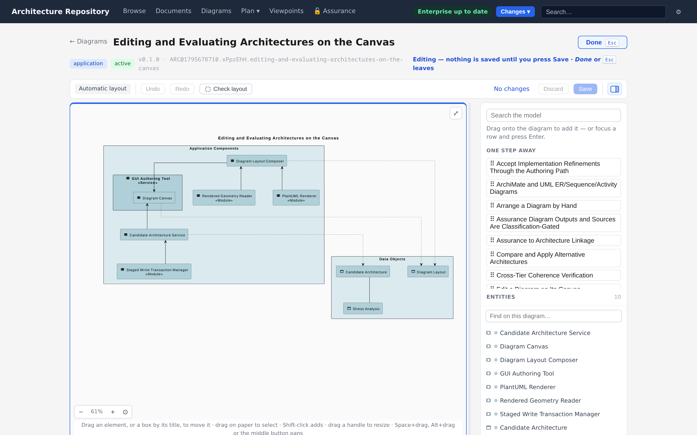

# Edit a diagram on its canvas

This guide arranges an ArchiMate diagram by hand, adds an element and a relation to it, and saves
the result. Every key, menu item and preference it mentions is listed in the
[Diagram canvas reference](../reference/diagram-canvas.md).

The canvas edits ArchiMate diagrams of the engagement repository. For other diagrams **Edit** opens
the diagram's editor page. A diagram whose PlantUML body is written by hand
(`manual-layout`) is laid out automatically first; see
[A diagram with a hand-written body](#a-diagram-with-a-hand-written-body).

&nbsp;

## Two modes

A diagram page opens in **view mode**, where the diagram is read: a click selects, a drag pans and
the wheel zooms. **Edit** in the header, or `E` with the diagram focused, switches to **edit mode**.
The header then shows only **Done**, and the line under the title reads *Editing — nothing is saved
until you press Save*.

In edit mode a drag on an element moves it, and a drag on empty paper draws a selection rectangle.
Panning moves to `Space` + drag, `Alt` + drag or a drag with the middle button, and the wheel still
zooms. **Done** or `Esc` returns to view mode; with unsaved changes, the bar asks whether to
**Save and exit**, **Discard and exit** or **Keep editing**. Opening another diagram or page with
unsaved changes asks the same question, and **Discard** asks before it throws changes away.

Nothing reaches the repository before **Save**. Until then every change is a step in the session's
undo history.



&nbsp;

## Worked example: arrange a diagram and add an element

The example uses the self-model's diagram *Editing and Evaluating Architectures on the Canvas*. It
adds a **Picture Cache** application component that serves the *Diagram Layout Composer* and saves
both the new element and the arrangement. The diagram's picture is generated from the model; a picture
drawn by hand can be arranged but not changed, as [below](#a-diagram-with-a-hand-written-body) explains.

### 1. Take the picture over

Open the diagram and select **Edit**. The chip at the left of the edit bar reads
**Automatic layout**: the picture is PlantUML's own arrangement.

Drag *Diagram Layout Composer* a little to the right. The first move takes the picture over:
the chip changes to **Arranged by hand**, and a notice offers **Undo**. From here on the diagram
keeps the positions you give it. Taking over keeps every line PlantUML drew; only the lines that
touch what you moved are routed again, so the first drag is quick on a large diagram too.

While you drag, the element snaps to an 8 px grid and to the edges and centres of its neighbours,
and dashed guides show what it lines up with. To move without snapping, choose *show alignment
guides only as hints* in [Preferences](../reference/diagram-canvas.md#preferences).

### 2. Create an element where it belongs

Right-click on empty paper inside the *Application Components* box. The picker opens with the
heading **Add to Application Components** and a search field.

1. Type `Picture Cache`. No model element is called that, so the picker offers
   **Create “Picture Cache” as…**.
2. Choose **application component** from the types below it.
3. The **New element** form opens with the name filled in and the **Project** preselected with the
   project used most on this diagram. Select **Create draft**.

The element appears at the point you clicked, with a small grey **d** in its corner: it is a draft.
A draft created in this session can be taken back with **Discard this draft** from its menu, and
**Undo** removes it like any other step.

### 3. Draw a relation

Press the edge of *Picture Cache* and drag to *Diagram Layout Composer*. The side you start
from lights blue while you hover it. On release the relation form lists two choices:

- **In the model: draw it** — relations the model already holds between the two elements. Choosing
  one draws it on this diagram only.
- **Not in the model: create it** — the relation types the ontology permits between the two types.
  Choosing one creates the relation in the model when you save.

Choose a type under **Not in the model: create it** and select **Draw relationship**. The pending
relation is drawn in the accent colour until it is saved.

**Connect to…** in the element's menu does the same without a drag: name the other element, then
choose the relation.

### 4. Review the change list

The edit bar now reads, for example, **3 changes · 2 to the model**. Select it to open the list
headed **Save will write**:

```
Model   2 changes to the model — every diagram that draws these sees them
        Create element: Picture Cache
        Create relationship: Picture Cache — serving → Diagram Layout Composer
Diagram 1 change to this diagram only
        Layout changed
```

The list names every model change. Arrangement is one row, **Layout changed**, however many
elements and lines moved.

### 5. Save

Select **Save**. Because the session changes the model, the list opens first and asks for
**Confirm and save**. A session that only arranges the picture saves in one press; choose *always*
under *Show the list of changes before saving* in Preferences to be asked every time.

The model changes and the diagram are written in one transaction, model changes first. If the model
refuses one of them, nothing is written, the reason appears in the edit bar and the list stays open.
You stay in edit mode after a save.

&nbsp;

## Arranging

Select several elements with a selection rectangle or with `Shift`-click, then right-click one of
them. The selection menu offers:

- **Align ▸** — left, centre or right edges, top edges, middles or bottom edges.
- **Distribute ▸** — equal gaps horizontally or vertically; the outer two stay where they are. It is
  offered from three elements on.
- **Put in a new box…** — a labelled box round the selection, drawn on this diagram only.
- the stacking order: **Bring to front**, **Bring forward**, **Send backward**, **Send to back**.
- **Remove from diagram** — the elements stay in the model.

A line is reshaped by dragging it: an end slides along its element's outline or moves to another
side, a segment moves sideways, and a double-click adds or removes a bend. Its menu offers
**Straighten**, **Move end to side ▸** and **Edit relation…**.

**Return to automatic** on the **Arranged by hand** chip gives the picture back to PlantUML. It is
one undoable step.

&nbsp;

## Nesting and boxes

Drag an element over a box or an element that may hold it. While you drag, the target that would
accept the drop lights up with what it would do: *Into Application Components* for a box, *Nest in
Diagram Layout Composer…* for an element. A target that would refuse the drop is not lit.

- **Into a box** changes the diagram only. A box that selects its members by a rule, such as a
  layer box, takes only what its rule admits.
- **Into an element** is a model change. ArchiMate reads an element drawn inside another as
  composition or aggregation, so the canvas asks *Make Picture Cache part of Diagram Layout Composer?*
  and offers the containment types the ontology permits, or **Don't nest**. Where the ontology
  permits none, the drop is refused with the reason.

**Nest in…** in the element menu does the same from the keyboard, and **Take out of ‹box›** moves
an element onto the box around it.

The layer and type boxes of an automatic picture are computed. The first time you rename, resize or
delete one, the diagram writes down its boxes and edits them from there; **Return to automatic
boxes** in the edit bar drops them again. Right-click a box's title band for **Rename box…**,
**Box by type ▸** and **Delete box**. Deleting a box keeps what it holds on the diagram.

&nbsp;

## Editing what an element is

The element menu holds the model edits:

- **Rename** (also `F2` or a double-click). The form says how many other diagrams draw the element
  and will show the new name.
- **Edit details…** — status, summary, keywords, specializations and attributes, kept with the
  session until Save.
- **Add another occurrence here** — the same element drawn a second time, at the point where the
  menu was opened.
- **Delete from model…** — asks first, lists the relations that go with it, and offers
  **Remove from diagram instead**.

Edits to a draft go through its creation form, so **Edit details…**, **Open** and **Add another
occurrence here** wait until it is saved.

&nbsp;

## Adding what the model already holds

The sidebar's **Search the model** finds elements; drag a row onto the canvas, or focus it and press
`Enter`. Below the search it lists **Relations in the model, not drawn** between the elements on the
diagram, each with **Draw**, and the elements **One step away** and **Two steps away** from them.
The sidebar toggle in the edit bar shows and hides it; a large diagram opens with it closed.

&nbsp;

## Checking the layout

**Check layout** in the edit bar marks the lines that break the layout rules: a line that runs
through text, bends right behind an arrowhead, runs along another line or a border, jogs, crosses
an element it does not join, or joins two elements drawn over each other. Each breach is a dashed
band on the canvas, with its sentence on hover; the button's tooltip lists them all. The verifier
reports the same rules as warnings when the diagram is checked (see
[Storing a layout](diagramming.md#storing-a-layout)).

&nbsp;

## Large diagrams

A diagram that fits the window only below 35 % opens at 60 % on its top-left box instead of shrunk
to fit. While the pointer is over the canvas and part of the picture is out of sight, an overview in
the corner shows where the window is; press or drag on it to move there. `0` fits the whole
diagram, and `+` and `−` zoom.

&nbsp;

## The reading lens while editing

Colours by an attribute, printed attributes and the legend chosen in **Display options** stay on
the picture when you switch to edit mode, so a diagram coloured by, say, lifecycle status can be
arranged in those colours. The panel itself is hidden while editing; change the lens in view mode.
See [Display options](diagramming.md#display-options-reading-a-diagram-your-own-way).

&nbsp;

## A diagram with a hand-written body

A `manual-layout` diagram keeps the PlantUML body its author wrote, so the canvas cannot arrange it.
Its page offers **Lay out automatically…** instead of **Edit**. The dialog shows the hand-written
picture beside the generated one and states that the hand-written body is replaced; the version it
replaces stays in the diagram's history and can be restored from there. Confirm with
**Lay out automatically**, and **Edit** is offered from then on.

The dialog refuses when the diagram changed after the page read it. Reload the page and look at the
current body before laying it out.

A diagram without `manual-layout` can still have a picture drawn by hand: boxes, further drawings of
an element or relations that its generated picture would not have. Such a diagram is edited on the
canvas, and edit mode says *This diagram's picture is drawn by hand*. Arranging it is saved. Adding
or removing what it draws is not, because the save would replace the hand-drawn picture with a
generated one. Its page also offers **Lay out automatically…** for that. Under the notice,
**What only the hand-drawn picture has** lists those boxes, elements and relations by name.

&nbsp;

## From an agent

The canvas and the MCP tools produce the same layout for the same command:
`artifact_arrange_diagram` takes layout patches and intents (align, distribute, straighten, nest,
group), and `artifact_replace_diagram` saves a whole diagram with its model commands. See
[Arranging and saving a diagram](candidate-architectures.md#arranging-and-saving-a-diagram).

---

*Reference: [Diagram canvas](../reference/diagram-canvas.md) · Next: [Icons on diagram elements →](icons.md)*
